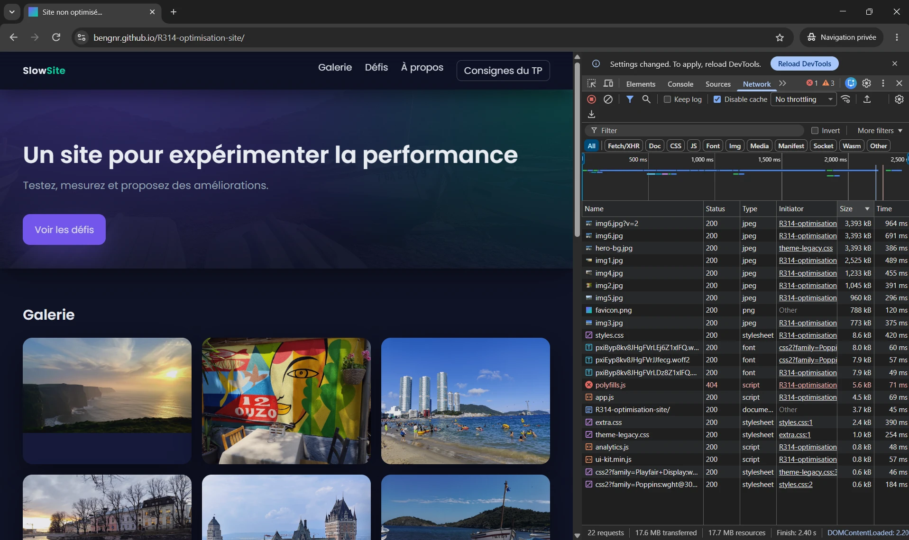
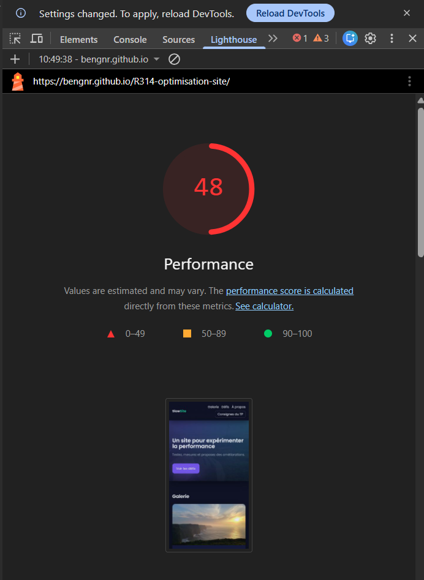
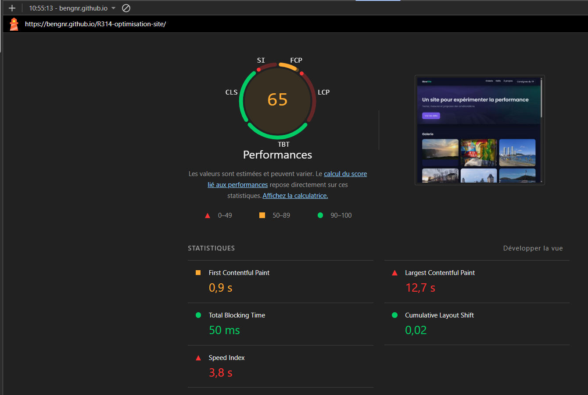
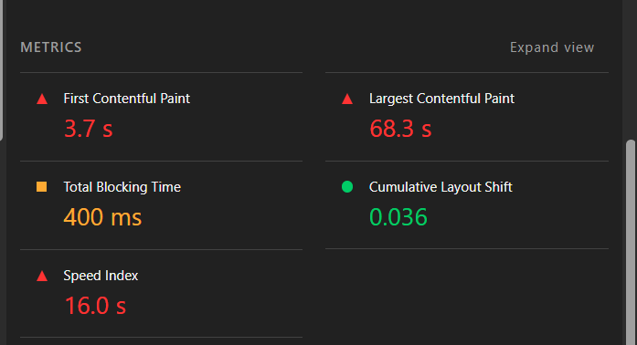
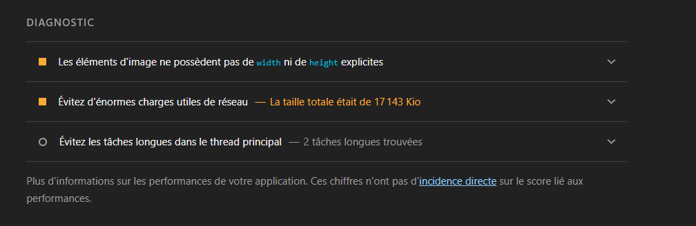
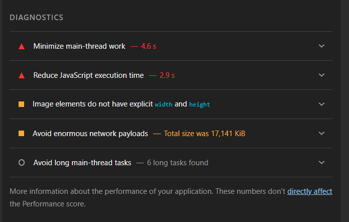
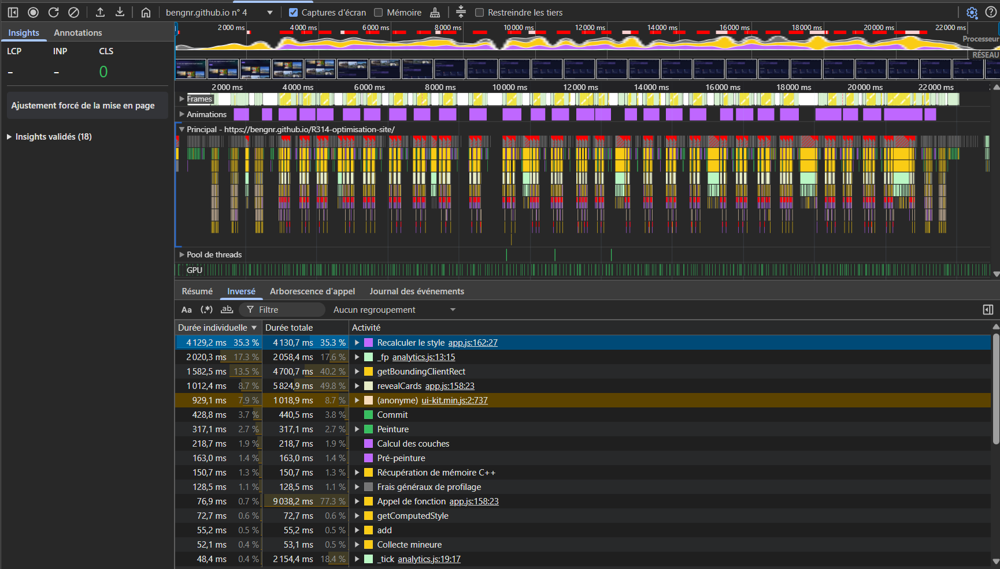
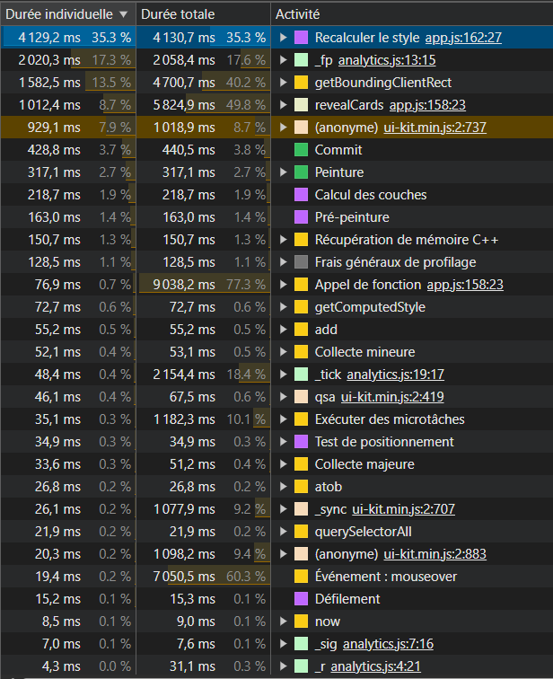
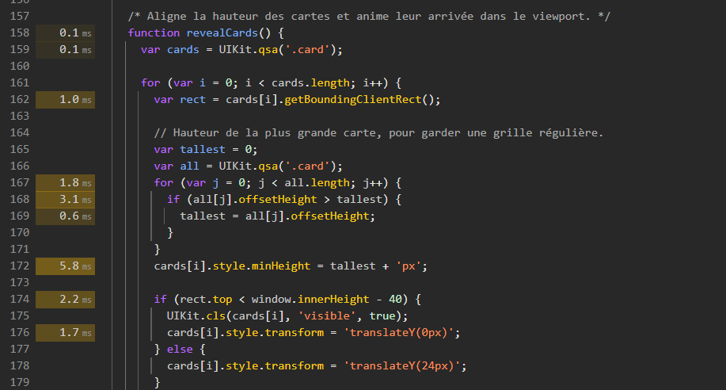
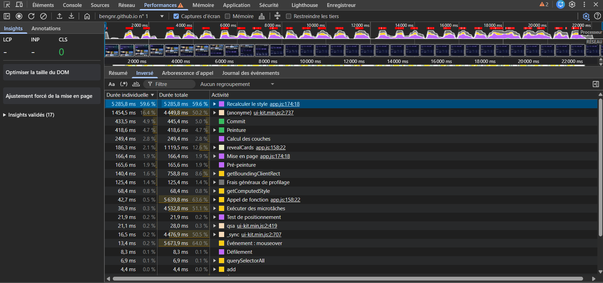

# Rapport d'optimisation — SlowSite (R3.14)

**Auteur :** Benjamin Granier — BUT MMI
**Dépôt (fork) :** https://github.com/bengnr/R314-optimisation-site
**Site publié :** https://bengnr.github.io/R314-optimisation-site/
**Site d'origine (référence) :** https://nico3807.github.io/R314-optimisation-site/ (commit `5f729eb`)

Mission : rendre le site rapide **sans rien changer à ce que voit l'utilisateur** (iso-rendu). Aucun outil de build ni CDN ajouté : le site reste servi tel quel par GitHub Pages.

---

## 1. Méthode et conditions de mesure

### Trois états mesurés

| État | Commit | Contenu |
|---|---|---|
| **ORIGINE** | `5f729eb` | Site de départ, non modifié |
| **APRÈS-JS** | `00dce20` | Après les 4 premières corrections JavaScript (ui-kit, analytics, revealCards, innerHTML) |
| **FINAL** | `1c07f8a` | Toutes les corrections : images, chaîne critique, JS restant, CSS |

L'audit initial a été fait sur mon fork **avant toute modification** (le 25/10/2026 à 10h49, alors que le fork était identique à `nico3807/main`, voir `audit/00-origine-preuve-fork-a-jour.png`). Les mesures finales de comparaison sont faites sur le site d'origine encore en ligne chez nico3807 : j'ai vérifié qu'il est identique octet pour octet au commit `5f729eb` (même empreinte md5 de `index.html` et de `ui-kit.min.js`).

### Outils

| Outil | Conditions | Utilisé pour |
|---|---|---|
| DevTools Chrome — Réseau, Lighthouse, Performances | Navigation privée, cache désactivé, CPU ×4 pour Performances, enregistrement > 20 s avec scroll | Audit initial et preuves (captures dans `audit/`) |
| Lighthouse 12 en ligne de commande | Chrome 156 local, headless, navigation privée, profils par défaut **Mobile** (Moto G Power émulé, 4G lente, CPU ×4) et **Desktop**, **3 essais, médiane** | Tableau avant/après, dans les mêmes conditions pour ORIGINE et FINAL |
| Chrome DevTools Protocol (script) | Navigation privée, cache désactivé, fenêtre 1440×900, CPU ×4, **20 s de défilement continu** | Poids et nombre de requêtes réels, long tasks et temps de style pendant l'usage |
| Couverture CSS (`CSS.startRuleUsageTracking`, équivalent de l'onglet Coverage) | Accueil + page de détail, après défilement complet | Identifier le CSS inutilisé |
| Captures pleine page + comparaison pixel (PSNR, ffmpeg) | 1440 px et 375 px (mobile ×2), même script avant/après | Prouver l'iso-rendu |

### Limites méthodologiques

- **Pas de données de terrain (CrUX)** : le site n'a pas assez de trafic réel, tout repose sur des données de laboratoire.
- **PageSpeed Insights** : l'API publique a renvoyé « quota dépassé » au moment de mes relevés. Les scores sont donc ceux de Lighthouse en local, même moteur, mais sur ma machine. Les mesures ORIGINE et FINAL ont été faites sur la même machine, à la suite.
- **Les temps varient** d'un essai à l'autre (la méthodologie du TP signale un TBT bimodal sur ce site) : je donne la médiane de 3 essais et je raisonne en ordres de grandeur. **Le poids et le nombre de requêtes sont fiables au kilo-octet près.**
- Toutes les mesures « avant/après » sont faites **sur les sites déployés** (GitHub Pages compresse les fichiers texte en gzip). Le serveur local (`python -m http.server`) n'a servi qu'à itérer.

---

## 2. Tableau avant / après

Lighthouse 12.8.2, Chrome 156, navigation privée, **médiane de 3 essais** par profil. Les deux sites sont mesurés à la suite, sur la même machine. Détail des 3 essais : `audit/12-lighthouse-3-essais-medianes.txt` ; rapports complets : `audit/10-lighthouse-origine-*.html` et `audit/11-lighthouse-final-*.html`.

| Indicateur | ORIGINE mobile | **FINAL mobile** | ORIGINE desktop | **FINAL desktop** |
|---|---|---|---|---|
| Score Performance | 46 | **98** | 65 | **100** |
| Poids total | 17 139 Kio | **403 Kio** (−97,6 %) | 17 139 Kio | **403 Kio** |
| Requêtes | 22 | **14** | 22 | **14** |
| FCP | 3,6 s | **0,9 s** | 1,0 s | **0,3 s** |
| LCP | 71,4 s | **1,9 s** | 12,8 s | **0,6 s** |
| TBT | 492 ms | **0 ms** | 71 ms | **0 ms** |
| CLS | 0,000 | **0,000** | 0,025 | **0,000** |
| Speed Index | 13,3 s | 3,9 s | 3,7 s | **0,4 s** |

Profils : mobile = Moto G Power émulé, RTT 150 ms, 1,6 Mb/s, CPU ×4 ; desktop = RTT 40 ms, 10 Mb/s, CPU ×1. L'élément LCP est la `DIV.hero` dans les 4 cas (son fond `hero-bg.jpg`, voir P3).

Pour rappel, l'audit initial fait dans DevTools sur mon fork encore à l'origine donnait : mobile 48 (FCP 3,7 s, LCP 68,3 s, TBT 400 ms, CLS 0,036, SI 16,0 s) ; desktop 65 (FCP 0,9 s, LCP 12,7 s, TBT 50 ms, CLS 0,02, SI 3,8 s). Ces chiffres sont cohérents avec les miens.

Remarque honnête : le Speed Index mobile reste à 3,9 s sur 2 essais sur 3 (0,9 s sur le troisième). C'est la variance signalée par la méthodologie, sur un indicateur sensible au moment où les cartes et les images apparaissent en fondu (animations conservées pour l'iso-rendu).

### Gain étape par étape (profil Performances, captures DevTools, CPU ×4, 22 s de défilement)

| Problème | ORIGINE | Après correction |
|---|---|---|
| MutationObserver + `_sync` (ui-kit) | « Recalculer le style » 5 285 ms, `_sync` 4 476 ms | supprimés |
| analytics.js (`_fp` / `_tick`) | 2 146 ms cumulés | supprimé |
| revealCards (reflow forcé) | 937 ms ; style 3 635 ms | disparu ; style 476 ms |
| buildKeywordIndex (`innerHTML +=`) | 573 ms | 3,2 ms |

### Réseau réel (Chrome, navigation privée, cache désactivé, 1440×900, chargement sans défilement)

| | ORIGINE | FINAL | Gain |
|---|---|---|---|
| Requêtes | 22 (dont 1 en 404) | **14** (0 erreur) | −8 |
| Poids transféré | 17 139 Ko | **403 Ko** | **−97,6 %** |
| Domaines contactés | 3 (github.io, fonts.googleapis.com, fonts.gstatic.com) | **1** | −2 |

### Usage réel : 20 s de défilement, CPU ×4, fenêtre 1440 px

C'est la mesure qui correspond à la plainte du client (« sur mon portable ça rame après quelques secondes ») : elle inclut le minuteur d'analytics.js, qui ne se déclenche qu'après 6,5 s et au-delà de 1024 px de large.

| | ORIGINE | FINAL |
|---|---|---|
| Long tasks (> 50 ms) | **95** (jusqu'à 392 ms) | **0** (2 mesures) |
| Temps bloquant cumulé (part > 50 ms des long tasks) | **11 223 ms** | **0 ms** |
| Exécution de script | 5 033 ms | 1 535 à 1 847 ms |
| Recalcul de style | 9 412 ms | 4 652 à 6 746 ms |

Même session en mobile 375 px : ORIGINE 57 long tasks (jusqu'à 338 ms), 6 083 ms bloqués ; FINAL **0 long task, 0 ms**. En 375 px, analytics.js ne se déclenche pas (condition « plus de 1024 px ») : le coût mobile d'origine venait de revealCards et d'ui-kit.

---

## 3. Audit initial (ORIGINE)

### Réseau

22 requêtes, **17,6 Mo transférés**, chargement terminé en 2,40 s (sans limitation réseau). Les 9 plus grosses ressources sont des images : img6.jpg (3,39 Mo) est téléchargée **deux fois** (`img6.jpg` et `img6.jpg?v=2`), hero-bg.jpg (3,39 Mo) est une troisième copie du même fichier, `favicon.png` pèse 788 Ko, et `polyfills.js` répond **404**.

### Lighthouse

| Mobile | Desktop |
|---|---|
|  |  |
|  |  |

Diagnostics mobile : 4,6 s de travail du thread principal, 2,9 s d'exécution JavaScript, 17 141 Kio de charge réseau, images sans `width`/`height`, 6 long tasks.

Écart mobile/desktop : TBT 400 ms en mobile contre 50 ms en desktop, LCP 68,3 s contre 12,7 s. C'est un premier indice : le coût vient à la fois du poids (réseau lent du profil mobile) et du CPU (ralenti ×4 en mobile).

### Performances (CPU ×4, 22 s avec défilement)

Blocs rouges en continu pendant le défilement, puis à intervalle régulier : un minuteur.

Les premières lignes du Bottom-Up désignent les coupables : `Recalculer le style` déclenché depuis `app.js:162` (4 129 ms), `_fp` dans `analytics.js:13` (2 020 ms), `getBoundingClientRect` (4 700 ms au total), `revealCards` (5 825 ms au total), une fonction anonyme de `ui-kit.min.js:2` (929 ms) et `_sync` (1 078 ms au total).

### Coverage CSS

Mesuré sur l'accueil (fichier complet dans `audit/04-coverage-css-avant-nettoyage.txt`) :

| Feuille | Taille | Utilisé | Inutilisé |
|---|---|---|---|
| styles.css | 92 045 o | 3 658 o | **96,0 %** |
| extra.css | 28 831 o | 141 o | **99,5 %** |
| theme-legacy.css | 1 249 o | 245 o | 80,4 % |
| Google Fonts Poppins (CSS) | 3 639 o | — | — |
| Google Fonts Playfair (CSS) | 6 556 o | 0 o | **100 %** |
| **Total** | **133 484 o** | **4 752 o** | **96,4 %** |

---

## 4. Problèmes identifiés et corrections

Pour chaque problème : où il est, ce qu'il fait, la preuve, ce qu'il coûte, la correction et le gain mesuré. Un commit par correction (historique : section 8).

### Niveau 1 — Images et réseau

#### P1. Images de la galerie 5 à 10 fois trop grandes

| Champ | Contenu |
|---|---|
| Fichier et ligne | `index.html:74-89`, `img/img1.jpg` à `img6.jpg` |
| Nature | Photos de 2040 à 3968 px de large (0,77 à 3,39 Mo) affichées dans des colonnes d'au plus 388 px. Pas de `srcset`, pas de `width`/`height`, pas de chargement différé. |
| Preuve | Réseau : img6 3 393 ko, img1 2 525 ko, img4 1 233 ko… ; propriétés des fichiers ; Lighthouse « Image elements do not have explicit width and height » |
| Coût | 9,9 Mo pour les 6 images de la galerie (hors doublon `img6.jpg?v=2`) |
| Correction | Variantes 380 / 760 / 1200 px en JPEG qualité 75 (`img{n}-380.jpg`…). `img{n}.jpg` remplacé par sa version 760 px pour ne casser aucun lien. Dans `index.html` : `srcset`, `sizes` déduit des media queries réelles du CSS, `width`/`height` (img1 760×429, les autres 760×570), `decoding="async"`, `loading="lazy"` sur la 2e rangée seulement (img4 à img6). La 1re rangée, visible d'emblée, reste en chargement immédiat. |
| `sizes` | `(max-width: 560px) 92vw, (max-width: 900px) calc(46vw - 9px), (max-width: 1304px) calc(30.67vw - 12px), 388px`. Dérivation : conteneur `min(1200px, 92%)`, grille 3 colonnes avec 18 px d'écart, 2 colonnes sous 900 px, 1 colonne sous 560 px. Au-delà de 1304 px, le conteneur plafonne à 1200 px : (1200 − 2×18) / 3 = 388 px. |
| Gain mesuré | En 1440 px, le navigateur choisit `img{n}-760.jpg` (vérifié via `currentSrc`) : 339 ko pour les 6 images, contre 9,9 Mo (−96,6 %). **CLS** : hauteur de page identique avant/après (2 379 px), les dimensions sont réservées. |
| Commits | `03a15ab`, `d6501e4` |

#### P2. Image servie deux fois (`img6.jpg?v=2`)

| Champ | Contenu |
|---|---|
| Fichier et ligne | `index.html:12` : `<link rel="preload" as="image" href="img/img6.jpg?v=2">` |
| Nature | La query string fait de l'URL une ressource différente de celle du `` : 3,39 Mo téléchargés deux fois. De plus, on précharge une image hors écran, ce qui vole de la bande passante au rendu initial. |
| Preuve | Réseau : deux lignes `img6.jpg` et `img6.jpg?v=2` de 3 393 ko. Console : « préchargée… n'a pas été utilisée après quelques secondes » (`audit/00-origine-reseau-firefox.webp`). |
| Correction | Suppression du preload. |
| Gain mesuré | −1 requête, −3,39 Mo |
| Commit | `8f0a611` |

#### P3. Texture du bandeau de 3,4 Mo affichée à 4 % d'opacité, et élément LCP

| Champ | Contenu |
|---|---|
| Fichier et ligne | `css/theme-legacy.css:8-14`, `.hero::before { background:url('../img/hero-bg.jpg'); opacity:.04 }` |
| Nature | hero-bg.jpg (3968×2976, 3,39 Mo, copie exacte d'img6) est téléchargée alors qu'on la voit à peine. Elle est découverte tard (HTML → styles.css → extra.css → theme-legacy.css → image). **Mesure** (PerformanceObserver `largest-contentful-paint`, de 375 à 1440 px) : l'élément LCP est la `DIV.hero`, à cause de ce fond. C'est ce qui explique le LCP de 68 s en mobile. |
| Preuve | Réseau : hero-bg.jpg 3 393 ko, initiateur `theme-legacy.css` ; mesure LCP. |
| Correction | Règle CSS conservée (iso-rendu). Fichier remplacé par une version de 800×600 px en qualité 40 (une texture n'a pas besoin d'être nette), puis `<link rel="preload" as="image" href="img/hero-bg.jpg" fetchpriority="high">` pour la découvrir dès le `<head>`. |
| Gain mesuré | 3 390 Ko → **40 Ko**. Comparaison pixel du bandeau : PSNR 52,5 dB (différence invisible). |
| Commits | `38fbb43`, `27470df` |

#### P4. Favicon de 788 Ko

| Champ | Contenu |
|---|---|
| Fichier | `img/favicon.png` (512×512) |
| Nature | Une icône affichée en 16 à 32 px pèse plus que toute la page finale. |
| Correction | PNG de 64×64 optimisé, même nom. |
| Gain mesuré | 787 Ko → **3,4 Ko** |
| Commit | `38fbb43` |

#### P5. Pages de détail : image de 4000 px sans contrainte

| Champ | Contenu |
|---|---|
| Fichier et ligne | `img1.html` à `img6.html:16`, aucune règle CSS pour `.image-wrapper` |
| Nature | L'image s'affichait à sa largeur native (jusqu'à 3968 px) : défilement horizontal sur tous les écrans (défaut A1 du guide). |
| Preuve | `audit/00-origine-page-img4-desktop.png` (page de 1801 px de haut, image qui déborde) |
| Correction | `.image-wrapper img{display:block;max-width:100%;height:auto}`, plus `srcset`/`sizes`, `width`/`height` et `fetchpriority="high"` (c'est l'image principale de ces pages). |
| Gain mesuré | Plus de défilement horizontal (`audit/02-apres-images-page-img4-desktop.png`). C'est la seule correction qui modifie volontairement l'affichage : elle supprime un défaut que le guide désigne comme tel. |
| Commit | `b7ef043` |

#### P6. Script 404 bloquant

| Champ | Contenu |
|---|---|
| Fichier et ligne | `index.html:16` : `<script src="js/legacy/polyfills.js">` |
| Nature | Fichier inexistant, appelé en synchrone dans le `<head>` : un aller-retour complet qui bloque le parsing pour rien. |
| Preuve | Réseau : `polyfills.js` en 404. J'ai cherché d'autres références manquantes (`src`/`href` de tous les `.html`, `url()` des CSS) : il n'y en a pas d'autre. |
| Correction | Suppression de la ligne. |
| Commit | `b6bcb85` |

#### P7. `dns-prefetch` vers un domaine jamais contacté

| Champ | Contenu |
|---|---|
| Fichier et ligne | `index.html:9` : `<link rel="dns-prefetch" href="https://cdn.jsdelivr.net">` |
| Preuve | Aucun fichier ne référence jsdelivr (grep), et le domaine est absent de l'onglet Réseau. |
| Correction | Suppression. |
| Commit | `7eb7b6b` |

#### P8. Chaîne d'`@import` CSS (chaîne critique)

| Champ | Contenu |
|---|---|
| Fichier et ligne | `styles.css:1-2` (`@import extra.css`, `@import Poppins`), `extra.css:1` (`@import theme-legacy.css`), `theme-legacy.css:3` (`@import Playfair Display`) |
| Nature | Chaque feuille n'est découverte qu'après le téléchargement de la précédente : 4 niveaux en série, tous bloquants pour le rendu. Playfair Display (4 graisses) n'est utilisée que par des classes `.legacy-*` absentes de toutes les pages. |
| Preuve | Réseau : initiateurs en cascade (`styles.css:1` → `extra.css:1` → `theme-legacy.css:3`) ; Coverage Playfair : 100 % inutilisé. |
| Correction | `<link>` parallèles dans le HTML, dans l'ordre de cascade d'origine, puis fusion en un seul fichier après le nettoyage (P15). Import Playfair supprimé. |
| Commits | `b8ab314`, `2f20787` |

#### P9. Polices : `display=block`, graisse inutile, preload mal formé

| Champ | Contenu |
|---|---|
| Fichier et ligne | `styles.css:2` (`Poppins:wght@300;400;600&display=block`), `index.html:10` (preload sans `crossorigin`) |
| Nature | `display=block` masque le texte tant que la police n'est pas arrivée (FOIT). La graisse 300 n'est utilisée par aucune règle : le texte est en 400, et le 700 des titres et du logo se rabat sur 600. Le preload pointait justement sur la graisse 300, **sans `crossorigin`** : c'est un téléchargement en double, inutile. Deux domaines tiers (googleapis + gstatic). |
| Preuve | Réseau : 3 woff2 + 2 CSS Google ; console : preload de police « non utilisé » ; grep des `font-weight`. Contrôle des caractères des pages : aucun ne relève du sous-ensemble latin-ext (← et les emojis tombaient déjà en police système). |
| Correction | Poppins hébergée en local (`fonts/poppins-400-latin.woff2`, `poppins-600-latin.woff2`, 7,7 + 7,8 Ko), `font-display:swap`, même `unicode-range` que Google, deux preloads corrects avec `crossorigin`. |
| Gain mesuré | −3 requêtes (2 CSS + 1 woff2), −2 domaines, plus de FOIT. Comparaison pixel des zones de texte : **identique** (PSNR infini). |
| Commit | `e26dcb6` |

#### P10. Scripts bloquants dans le `<head>`

| Champ | Contenu |
|---|---|
| Fichier et ligne | `index.html:17-18` et `img{n}.html:9-10` |
| Correction | `defer` sur `ui-kit.min.js` et `app.js` : téléchargement en parallèle, exécution après le parsing **dans l'ordre**. UIKit est donc défini avant `app.js`. `UIKit.ready()` voit `readyState='interactive'` et lance l'initialisation aussitôt. Le script en ligne de fin de page ne dépend pas d'UIKit. |
| Commit | `a97118a` |

### Niveau 2 — Visible seulement dans un profil d'exécution

#### P11. `revealCards()` : reflows forcés et complexité quadratique au scroll

| Champ | Contenu |
|---|---|
| Fichier et ligne | `js/app.js:158` (`revealCards`), appelée sur `scroll`, `resize` et `load` (`app.js:213-215`) |
| Nature | Pour chaque carte, `getBoundingClientRect()`, puis un `querySelectorAll('.card')` et une lecture d'`offsetHeight` de **toutes** les cartes, puis une écriture de `minHeight` et de `transform`. Lectures et écritures alternent dans une boucle imbriquée : reflow forcé et coût en n², à chaque événement de scroll. Même chose sur les 371 cases du calendrier (`getBoundingClientRect` + écriture d'opacité). |
| Preuve | Bottom-Up : `revealCards` 5 825 ms au total (49,8 %), `getBoundingClientRect` 4 700 ms, « Recalculer le style » 4 129 ms (35,3 %) |
| Correction | `alignCards()` aligne les hauteurs au chargement et au redimensionnement seulement : toutes les lectures, puis toutes les écritures. Au scroll, un seul gestionnaire passif (`{passive:true}`), limité à une passe par image (`requestAnimationFrame`) : 6 lectures de position pour les cartes + 1 pour le calendrier, puis les écritures. Le style d'une carte n'est réécrit que si son état change. |
| Gain mesuré | `revealCards` 937 ms → disparu du profil (capture `audit/01b-apres-revealcards-bottomup.png`), « Recalculer le style » 3 635 ms → 476 ms à ce stade |
| Commits | `c52187a`, `03ef928`, `835385f` |

#### P12. ui-kit.min.js : MutationObserver × `getComputedStyle` sur tout le DOM

| Champ | Contenu |
|---|---|
| Fichier et ligne | `js/vendor/ui-kit.min.js:2` (minifié ; lisible via le pretty-print `{}`) |
| Nature | Trois pièges dans une dépendance d'apparence tierce : (1) `_cal: c()`, une boucle `while (performance.now() - t < 620)`, soit **620 ms de CPU bloqué au chargement** du script ; (2) `_pool: b()`, 240 000 objets alloués pour rien ; (3) un `MutationObserver` sur `document` (subtree + attributes + characterData) qui appelle `_sync`, lequel lit `getComputedStyle` de **tous** les éléments. Chaque écriture de style faite par `revealCards` au scroll déclenche donc un parcours complet du DOM : deux codes anodins qui s'amplifient. |
| Preuve | Bottom-Up : « Recalculer le style » 5 285 ms (59,6 %), `_sync` 4 476 ms au total ; `(anonyme) ui-kit.min.js:2:737` (la boucle) 929 ms |
| Coût | ~5,3 s de recalcul de style sur 22 s d'enregistrement, plus 620 ms bloqués au chargement |
| Correction | Suppression de `c()`, `b()`, de l'observer et de `_sync` (code mort : la propriété `__uk` qu'il remplit n'est lue nulle part). Les helpers réellement utilisés (`ready`, `qs`, `qsa`, `cls`) sont conservés. |
| Gain mesuré | `_sync` et la boucle disparaissent du profil (`audit/01a-apres-uikit-bottomup.png`) ; ui-kit.min.js : 1 101 → 821 octets |
| Commits | `acff506`, `569447d` |

#### P13. `buildKeywordIndex()` : `innerHTML +=` en boucle

| Champ | Contenu |
|---|---|
| Fichier et ligne | `js/app.js:74-83` |
| Nature | 320 `<option>` ajoutées par `list.innerHTML += …` : à chaque tour, tout le contenu existant est resérialisé puis réanalysé (coût quadratique). |
| Preuve | Bottom-Up : `set innerHTML` 690 ms, `buildKeywordIndex` 573 ms au total |
| Correction | `DocumentFragment` + `createElement('option')`, une seule insertion. |
| Gain mesuré | 573 ms → **3,2 ms** (`audit/01c-apres-js-bottomup.png`) |
| Commits | `03ef928`, `00dce20` |

#### P14. 371 transitions CSS relancées à chaque image de défilement

| Champ | Contenu |
|---|---|
| Fichier et ligne | `css/styles.css` : `.cal-day{…transition:opacity .25s linear}`, combiné à l'opacité recalculée au scroll |
| Nature | Une fois tout le JS lourd retiré, le défilement restait saccadé. Chaque case du calendrier porte sa propre transition d'opacité, et chaque nouvelle valeur au scroll **recrée 371 transitions par image**. Ce piège existait déjà à l'origine, masqué par les autres. |
| Preuve | Mesure CDP (CPU ×4, 20 s de défilement, 1440 px) : **125 long tasks, 11,4 s de recalcul de style** avec le JS déjà corrigé. J'ai isolé la cause par élimination. Sans `backdrop-filter` : inchangé (11,0 s). Sans les écritures d'opacité : 0 s. **Sans la transition des cases : 1,9 s et 0 long task.** |
| Correction | Le même lissage (linéaire, 250 ms, repartant de la valeur courante à chaque nouvelle cible, exactement comme une transition CSS) est calculé en JS sur 7 valeurs, une par ligne, puisque les 7 cases d'une ligne ont le même haut. Seules les cases dont la valeur change sont réécrites. |
| Gain mesuré | **0 long task** (contre 125), recalcul de style ~7 s. Rendu : zone calendrier **identique au pixel près** à l'origine. Opacité intermédiaire 80 ms après un saut de défilement (0,15 → 0,46 → 1), comme à l'origine (0,15 → 0,34 → 1). |
| Commits | `1000fbb`, `1c07f8a` |

### Niveau 3 — Conditionnel

#### P15. analytics.js : minuteur CPU qui grossit, seulement sur grand écran et après 6,5 s

| Champ | Contenu |
|---|---|
| Fichier et ligne | `js/analytics.js:19-26` (`_tick`, boucle `while` l.23) et `:29` (`setTimeout` 6 500 ms puis `setInterval` 2 600 ms) ; chargé par `index.html:19` |
| Nature | Code obscurci : chaînes en base64 décodées par `atob`, soit `innerWidth`, `performance`, `now` et `hidden`. À chaque tick : hash de la signature de **tout le DOM** dans une boucle `while` de 46 ms, durée multipliée par 1,28 à chaque passage jusqu'à **430 ms**. **Conditions :** fenêtre de plus de 1024 px, onglet visible, au moins 6,5 s après le chargement. |
| Preuve | Frise de 22 s : blocs rouges à intervalle de 2,6 s (`audit/00-origine-perf-frise-22s.png`) ; Bottom-Up : `_fp` 2 020 ms, `_tick` 2 154 ms au total. **Incohérence entre deux mesures** : l'enregistrement de `audit/00-origine-perf-bottomup-sync.png`, pourtant fait sur le même code, ne contient aucun `_tick`. C'est la condition de largeur ou de durée qui n'était pas remplie. |
| Coût | Jusqu'à 430 ms de blocage toutes les 2,6 s pour un visiteur sur ordinateur qui reste sur la page. Invisible dans un audit Lighthouse court ou en profil mobile. |
| Correction | Suppression du script : il ne produit rien de visible et n'envoie rien. |
| Commit | `03ef928` |

### Niveau 1 bis — CSS et rendu

#### P16. CSS mort : 96 % des feuilles

| Champ | Contenu |
|---|---|
| Fichier | `styles.css` (1 199 règles `.redundant-N`, `.highlight`), `extra.css` (799 règles `.extra-N{filter:brightness()}`), `theme-legacy.css` (`.legacy-*`, `.tile*`) |
| Preuve | Coverage : 96,4 % inutilisé sur l'accueil, 99,3 % sur une page de détail. Ensuite, recherche de chaque classe dans **toutes** les pages qui chargent ces feuilles (index, img1 à 6) et dans `app.js` : aucune occurrence. |
| Correction | Suppression (commits `cbff30c`, `d215944`, `10df639`). La triple `box-shadow` d'`extra.css` sur `.card`, `.feature` et `.cta` était toujours écrasée par la règle de même spécificité de `styles.css`, chargée après : limitée à `.hero`, le seul élément où elle s'appliquait vraiment (`6dfba9e`). Puis fusion des 3 feuilles dans l'ordre de cascade et minification, **après** le nettoyage (`2f20787`). |
| Gain mesuré | 122 137 o → **5 396 o** de CSS (−95,6 %), 3 requêtes CSS → 1 (5 avec Google Fonts → 1). Captures 1440 et 375 px : identiques hors images recompressées. |

#### P17. Animation de `box-shadow` au survol du bouton

| Champ | Contenu |
|---|---|
| Fichier et ligne | `styles.css` : `.cta{transition:transform .2s, box-shadow .2s}`, `.cta:hover{box-shadow:…}` |
| Nature | Animer `box-shadow` impose une repeinture à chaque image de l'animation. |
| Correction | Les deux ombres (repos et survol) sont portées par `::before` et `::after`, dont seule l'**opacité** varie ; `transform` est conservé. |
| Gain / preuve | Captures repos et survol identiques à l'origine (`audit/05-cta-repos-survol-origine-vs-corrige.png`) |
| Commit | `be38ac2` |

---

## 5. Preuve d'iso-rendu

Captures pleine page réalisées par le même script (Chrome headless, défilement jusqu'en bas puis retour en haut, attente du décodage des images), puis comparées au pixel près (PSNR ; « infini » = pixels identiques).

| Zone (1440 px) | ORIGINE vs FINAL |
|---|---|
| Barre de navigation | identique (∞) |
| Bandeau (texture recompressée) | 51,9 dB |
| Galerie (photos recompressées en q75) | 35,7 dB |
| Calendrier d'activité | identique (∞) |
| Fonctionnalités, Défis, pied de page | identique (∞) |
| Hauteur de page | 2 379 px des deux côtés (375 px : 4 309 px des deux côtés) |

Un PSNR au-dessus de 35 dB correspond à une différence invisible à l'œil. Les seuls écarts viennent de la recompression JPEG ; mise en page, typographie et couleurs sont identiques.

Captures : `audit/00-origine-visuel-desktop.png`, `audit/00-origine-visuel-mobile.png`, et l'état APRÈS-JS `audit/01-apres-js-visuel-*.png`.

**Deux régressions d'iso-rendu introduites par mes premières corrections JS, trouvées grâce à ces comparaisons et corrigées :**
1. Le calendrier passait d'un dégradé progressif (`max(0.15, 1 − distance au centre / hauteur)`) à du tout-ou-rien (1 ou 0,4) avec l'IntersectionObserver. Dégradé rétabli (`1000fbb`) : PSNR de 29,8 dB → ∞ (`audit/03-calendrier-origine-vs-corrige.png`).
2. Les cartes ne rejouaient leur apparition qu'une fois (`unobserve`). À l'origine, une carte repassée sous l'écran redescend de 24 px et réapparaît au passage suivant. Comportement rétabli (`835385f`).

---

## 6. Ce qui n'a pas été changé, et pourquoi

- **`backdrop-filter: blur(6px)` de la barre de navigation fixe** : coûteux en composition, mais l'effet est visible quand le contenu passe dessous au défilement. Le supprimer violerait l'iso-rendu. J'ai mesuré l'effet de son retrait : 11,4 s → 11,0 s de style, gain négligeable. **C'est une optimisation qui n'aurait rien changé.**
- **Triple `box-shadow` sur `.hero`** : conservée (visible). Elle est statique, donc peinte une seule fois.
- **ui-kit.min.js** conservé : il n'a plus que 4 helpers (821 o) ; le remplacer par du natif ne ferait gagner qu'une requête.
- **Format WebP/AVIF** non appliqué : les JPEG redimensionnés pèsent déjà 339 ko pour toute la galerie. Un `<picture>` WebP serait la prochaine étape (−30 % environ).
- **Recalcul de style au scroll** (~7 s sur 20 s à CPU ×4) : c'est le coût inhérent de l'effet d'opacité du calendrier (371 cases à repeindre). Il ne produit plus aucune long task.

---

## 7. Ce qui n'est pas faisable sur GitHub Pages

| Levier | Sur GitHub Pages | Ce que je ferais sur un vrai serveur |
|---|---|---|
| Compression | gzip appliqué automatiquement ; vérifié : `Content-Encoding: gzip` même quand le navigateur annonce `br` (styles.css : 5 396 → 1 941 o) | Brotli niveau 11 précompressé pour HTML/CSS/JS/SVG (−15 à −20 % de plus que gzip), rien sur les JPEG/woff2 déjà compressés |
| `Cache-Control` | Imposé, vérifié : `Cache-Control: max-age=600` (10 min) sur toutes les ressources | `max-age=31536000, immutable` sur images, polices, CSS, JS ; `no-cache` (revalidation ETag) sur le HTML |
| Empreinte dans les noms | Impossible sans build | `styles.3f9a1c.css`, `app.8b2e.js` générés par un outil de build, pour un cache d'un an sans risque de servir une version périmée |
| HTTP/2, HTTP/3 | HTTP/2 fourni par le CDN de GitHub, pas de réglage | HTTP/3 (QUIC) ; avec HTTP/2, la fusion des CSS a moins d'intérêt |
| Early Hints (103) / en-têtes `Link: preload` | Impossible | Envoyer `103 Early Hints` pour `styles.css`, les 2 polices et `hero-bg.jpg` avant même le HTML |
| Négociation de format d'image | Impossible (pas de logique serveur) | Servir AVIF/WebP selon l'en-tête `Accept`, ou passer par un CDN d'images |
| CDN | Celui de GitHub (Fastly), non configurable | CDN avec points de présence proches des visiteurs et règles de cache par type |

---

## 8. Historique des commits (un commit = une optimisation)

| Commit | Correction |
|---|---|
| `c52187a` | Fix layout thrashing dans revealCards |
| `b0fdb90` | Retire .vscode du dépôt |
| `acff506` | Supprime MutationObserver, _sync, _cal et _pool dans ui-kit.min.js |
| `03ef928` | Remplace revealCards par IntersectionObserver, supprime analytics.js, corrige innerHTML en boucle |
| `00dce20` | buildKeywordIndex : DocumentFragment au lieu de innerHTML += en boucle |
| `ae8a62b` | Répare .gitignore (UTF-8) et retire .vscode du suivi |
| `38fbb43` | Recompresse hero-bg.jpg (800 px, q40) et favicon.png (64x64) |
| `03a15ab` | Galerie : variantes 380/760/1200 px (JPEG q75) de img1 à img6 |
| `d6501e4` | Galerie : srcset/sizes, width/height, lazy et decoding async |
| `b7ef043` | Pages img1..6 : srcset, dimensions, et largeur bornée au conteneur |
| `b6bcb85` | Supprime le script polyfills.js (404 bloquant dans le head) |
| `8f0a611` | Supprime le preload de img6.jpg?v=2 |
| `7eb7b6b` | Supprime le dns-prefetch vers cdn.jsdelivr.net |
| `e26dcb6` | Polices : Poppins hébergée en local (400/600 latin), font-display swap |
| `b8ab314` | Remplace la chaîne d'@import CSS par des <link> parallèles |
| `a97118a` | Scripts du head en defer (ordre ui-kit puis app.js conservé) |
| `27470df` | Précharge hero-bg.jpg en priorité haute (élément LCP) |
| `1000fbb` | Calendrier : rétablit le dégradé d'opacité d'origine, sans reflow |
| `569447d` | ui-kit : retire la propriété résiduelle _cal |
| `cbff30c` | CSS : supprime les 1199 règles .redundant-* et .highlight de styles.css |
| `d215944` | CSS : supprime les 799 règles .extra-N de extra.css |
| `10df639` | CSS : supprime .legacy-* et .tile* de theme-legacy.css |
| `6dfba9e` | CSS : limite la triple ombre de extra.css à .hero |
| `be38ac2` | CSS : survol de .cta animé en opacité au lieu de box-shadow |
| `2f20787` | CSS : fusionne les trois feuilles dans styles.css et minifie |
| `835385f` | Cartes : rétablit le rejeu de l'apparition au scroll (iso-rendu) |
| `1c07f8a` | Calendrier : remplace 371 transitions CSS relancées à chaque image |

Les deux premiers commits (`c52187a`, `b0fdb90`) sont des étapes intermédiaires : `c52187a` corrigeait déjà les lectures/écritures entrelacées de revealCards, et le `.vscode` retiré par `b0fdb90` a été réintroduit par `acff506`, puis définitivement exclu par `ae8a62b`.
